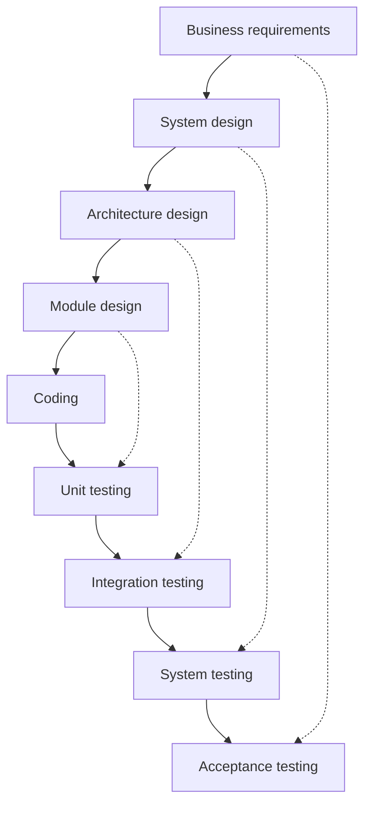

# V-Model and Program Correctness

## V-Model

The following text diagram represents the V-Model activities in the lab.

## Verification and Validation

| Activity | Classification | Reason |
| --- | --- | --- |
| Review the requirements document. | Verification | Checks whether requirements are correct and complete. |
| Inspect the test plan. | Verification | Checks whether the test plan meets the requirements. |
| Run a registration using valid details. | Validation | Checks whether the application works as expected. |
| Test that a full course rejects another student. | Validation | Checks whether the application correctly enforces course capacity. |

## Program Correctness

Given statement: assume x > 0; y = x + 1; assert y > x.

| Component | Answer |
| --- | --- |
| Pre-condition | x > 0 |
| Computation | y = x + 1 |
| Post-condition | y > x |

Several passing tests do not prove complete program correctness because testing only checks selected inputs and conditions. Other untested inputs may produce unexpected results or failures. Therefore, passing tests increase confidence in the software but cannot guarantee that it is completely free of defects.

## Reliability and Safety

| Operation | Count | Probability |
| --- | ---: | ---: |
| View courses | 400 | 40% |
| Search courses | 250 | 25% |
| Register | 200 | 20% |
| View status | 100 | 10% |
| Cancel registration | 50 | 5% |
| Total | 1000 | 100% |

Probability formula: count divided by total (1000).

### Most Frequent Operation

Viewing courses is the most frequent operation, representing 40% of total system usage. Therefore, greater testing effort should be allocated to viewing and searching courses. Registration should also receive significant attention because failures in this operation can affect students and course availability.

### Two Abnormal Conditions for Safety Testing

1. Network failure during registration: The system should prevent incomplete registrations and avoid inconsistent records when the connection is interrupted.
2. Repeated clicks on the Register button: The system should prevent duplicate registrations when a student clicks the button multiple times during a slow response.

### Difference Between Reliability and Safety

Reliability refers to the ability of software to perform its intended functions consistently over time under specified conditions. Safety refers to preventing harmful or dangerous situations caused by software failures. A reliable and safe registration system should process registrations consistently while preventing duplicate records, incorrect enrollment, and loss of student information.
